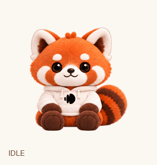

# LETSUR 렛서판다 for DAP

크림색 후디를 입은 LETSUR 렛서판다를 [Desk AI Pet](https://github.com/Project-Undonghae/mydeskpet)의 데스크톱 친구로 사용하는 스킨 플러그인입니다.

[최신 버전 다운로드](https://github.com/o-min222/dap-letsur-skin/releases/latest)



## 설치

**DAP 1.6.14 이상이 필요합니다.**

1. DAP의 플러그인 설치에서 `o-min222/dap-letsur-skin`을 입력하거나, [Releases](https://github.com/o-min222/dap-letsur-skin/releases/latest)의 `dap-letsur-skin-v0.1.0.zip`을 설치합니다.
2. 트레이 메뉴 또는 원형 메뉴에서 **LETSUR 렛서판다**를 엽니다.
3. **렛서판다와 함께하기**를 눌러 적용합니다.

**기본 캐릭터로 돌아가기**로 해제할 수 있습니다. 선택한 스킨은 재실행 후 복원되며, 다른 스킨으로 바꾸면 LETSUR 자동 복원도 해제됩니다. AI 말투는 변경하지 않습니다.

이미지가 모두 포함되어 있어 설치 후 외부 서비스나 이미지 다운로드가 필요하지 않습니다. DAP 본체를 수정하지 않습니다.

## 모션과 외형

- 쉬기·눈깜빡임, 좌우 이동, 인사, 점프
- 실패 반응, 입력 기다림, 노트북 작업, 얼굴 살피기
- 수면, 간식 먹기, 잡힘, 16방향 시선
- 그루밍은 얼굴 살피기를, 성공·춤은 기쁜 인사를, 두 번째 작업 슬롯은 노트북 작업을 공유합니다.

오렌지색 털, 흰 얼굴 무늬, 갈색 손발, 크림색 후디와 줄무늬 꼬리를 사용합니다. 눈에는 흰자위를 넣지 않으며 짙은 갈색·검정색 눈과 작은 반사광만 사용합니다.

`palette/index.html`을 브라우저로 열면 모션을 미리 볼 수 있습니다. 적용·해제 버튼은 DAP 안에서만 작동합니다. 일시정지와 운영체제의 동작 줄이기 설정을 지원합니다.

## 개발과 패키징

Node.js 22 이상과 Python 3를 사용하며, 추가 패키지 설치 없이 검증하고 ZIP을 만들 수 있습니다.

```sh
npm run verify
```

- `npm test`: 적용·해제·재실행 복원·다른 스킨 전환·오류 후 복구·정리 검증
- `npm run package`: 배포 파일과 스킨 정의를 확인하고 `dist/`에 ZIP과 SHA-256 체크섬 생성
- `assets/skin.json`: 모션별 프레임·속도와 192 × 208 px 셀 정의
- `assets/letsur-dap.png`: 1536 × 2912 px 투명 스프라이트 시트

저장소에는 DAP 실행에 필요한 이미지와 미리보기만 포함합니다. 대용량 제작 원본과 Codex용 파일은 별도로 보관해 DAP의 저장소 설치 용량 제한 안에서 배포합니다.

설치된 DAP 1.6.19의 스킨 API 구조와 등록·적용·해제 흐름을 검증했습니다. 실제 DAP 화면에서의 설치·선택은 아직 확인하지 않았습니다.

API 사용 방식은 [dap-chiikawa-friends](https://github.com/o-min222/dap-chiikawa-friends)를 참고했습니다. 해당 플러그인의 캐릭터 이미지·대사·성격 설정은 포함하지 않습니다.
